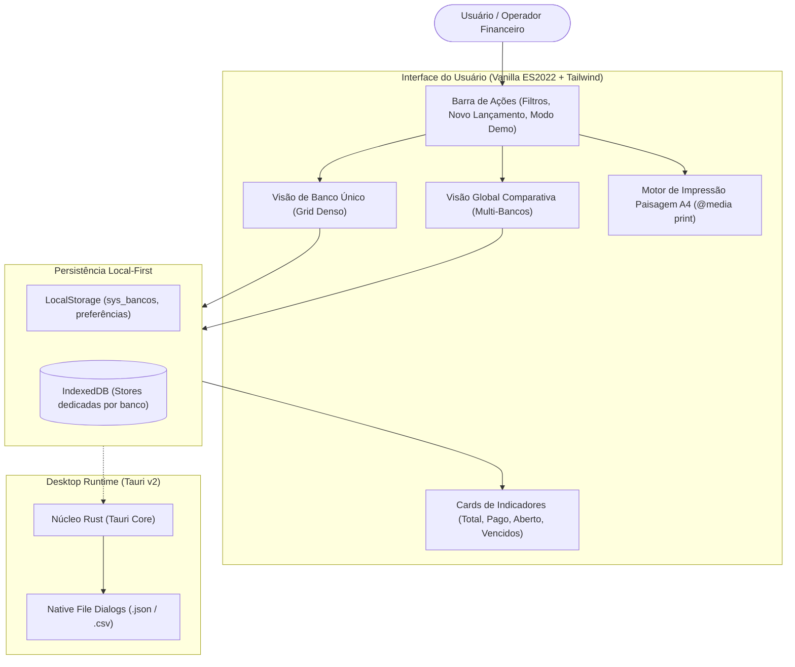

# 💰 Controle de Pagamentos PRO

[](https://wallacextreme.github.io/controle-de-pagamentos-pro/)
[](https://tauri.app/)
[](https://web.dev/progressive-web-apps/)
[](https://developer.mozilla.org/en-US/docs/Web/API/IndexedDB_API)
[](https://github.com/wallacextreme/controle-de-pagamentos-pro/releases)
[](LICENSE)

Sistema corporativo de alta confiabilidade para **Gestão Financeira de Pagamentos**, **Conciliação Multi-Bancos**, **Controle de Vencimentos** e **Automação Documental com Impressão em Paisagem A4**.

Projetado sob a filosofia **100% Offline-First**, o sistema opera com latência zero diretamente no navegador como **PWA** ou como aplicativo Desktop nativo compilado com **Tauri v2 (Rust)** para Windows (`.exe` e `.msi`).

---

## 🌐 Demonstração Online & Execução Rápida

- 🚀 **Demo Interativa no GitHub Pages:** [https://wallacextreme.github.io/controle-de-pagamentos-pro/](https://wallacextreme.github.io/controle-de-pagamentos-pro/)
- ✨ **Modo de Demonstração (1 Clique):** Ao abrir a demo, clique no botão **"✨ Modo Demo"** na barra superior para popular instantaneamente contas bancárias e lançamentos fictícios para testes de relatórios, gráficos e conciliação.

---

## 🎯 Problema de Negócio Resolvido

Operações comerciais e financeiras lidam diariamente com pagamentos pulverizados em múltiplos bancos (ex.: Itaú, Bradesco, Santander), dependendo de planilhas frágeis sujeitas a corrupção de fórmulas e lentidão. 

O **Controle de Pagamentos PRO** resolve esse cenário fornecendo:
1. **Conciliação Multi-Bancos Isolada:** Bancos independentes em instâncias dedicadas do IndexedDB, prevenindo contaminação de dados.
2. **Visão Global Comparativa:** Painel consolidado que calcula totais em tempo real, permitindo comparar despesas lado a lado.
3. **Motor de Impressão Paisagem A4 Inteligente:** `@page { size: landscape }` milimetricamente calibrado com auto-ocultação de bancos vazios e paginação limpa.
4. **Segurança e Privacidade por Design (LGPD):** Nenhum dado financeiro sai da máquina do usuário. Zero telemetria, zero servidores intermediários.

---

## 🏗️ Arquitetura do Software (Offline-First)



---

## ⚡ Principais Funcionalidades

- **Gerenciador de Bancos Dinâmico:** Crie, edite e personalize quantas contas bancárias forem necessárias (cores personalizadas, ordenação e exclusão segura).
- **Controle de Status e Alertas de Vencimento:** Categorização visual para títulos *Pagos*, *Em Aberto*, *Em Alerta ($\le 3$ dias)* e *Vencidos*.
- **Backups Criptograficamente Seguros:** Exportação e importação de backups gerais unificados em formato JSON com identificadores UUID v4.
- **Exportação CSV Homologada:** Exportação compatível com Excel e LibreOffice Calc com separador de ponto e vírgula e escaping estrito.
- **PWA Instalável com Service Worker:** Cache completo dos assets com funcionamento 100% autônomo sem internet.

---

## 💻 Como Executar Localmente

Como o frontend utiliza tecnologias nativas puras (Vanilla HTML5/JS + Tailwind Local), não é necessário compilar código para rodar no navegador:

### 1. Clonar o Repositório
```bash
git clone https://github.com/wallacextreme/controle-de-pagamentos-pro.git
cd controle-de-pagamentos-pro
```

### 2. Executar como Web App Local (PWA)
```bash
# Com Python 3
python -m http.server 8080

# Ou com Bun / Node.js
bunx serve .
```
Acesse `http://localhost:8080` no navegador.

### 3. Compilar Aplicativo Desktop Windows (Tauri v2)
```bash
# Instalar dependências da CLI Tauri
bun install

# Executar em modo de desenvolvimento desktop
bun run tauri dev

# Compilar instaladores .msi e .exe oficiais
bun run tauri build
```
Os instaladores Windows compilados serão gerados em `src-tauri/target/release/bundle/`.

---

## 📦 Releases Oficiais para Windows

Os instaladores Windows oficiais estão publicados na aba [Releases do GitHub](https://github.com/wallacextreme/controle-de-pagamentos-pro/releases):
- **Pacote MSI (Windows Installer):** `Controle de Pagamentos PRO_1.3.0_x64_en-US.msi`
- **Instalador NSIS (.EXE):** `Controle de Pagamentos PRO_1.3.0_x64-setup.exe`

---

## 👤 Autor

Desenvolvido por **Wallace Soares**
- **GitHub:** [@wallacextreme](https://github.com/wallacextreme)
- **LinkedIn:** [wallacextreme](https://linkedin.com/in/wallacextreme)
- **Portfólio:** [https://wallacextreme.github.io/portfolio/](https://wallacextreme.github.io/portfolio/)

---

## 📄 Licença

Distribuído sob a licença **MIT**. Consulte `LICENSE` para obter mais informações.
